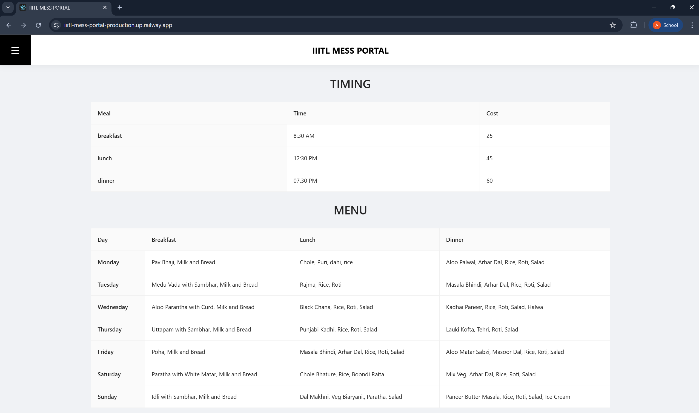
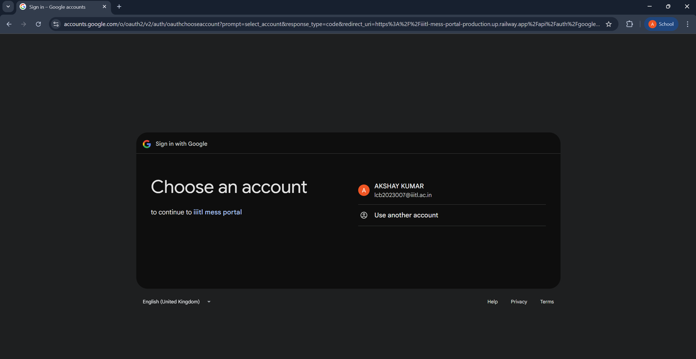
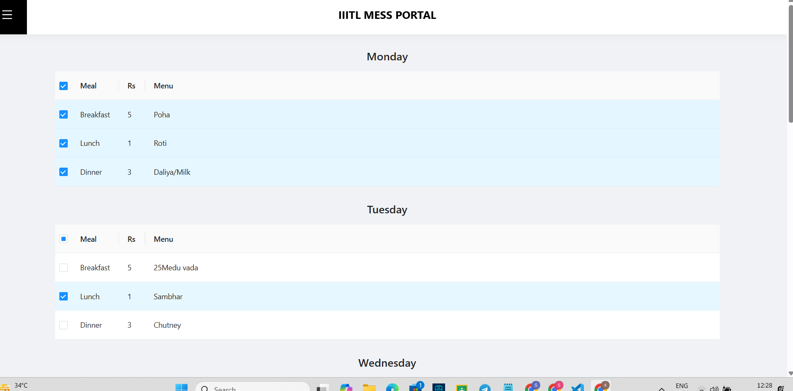
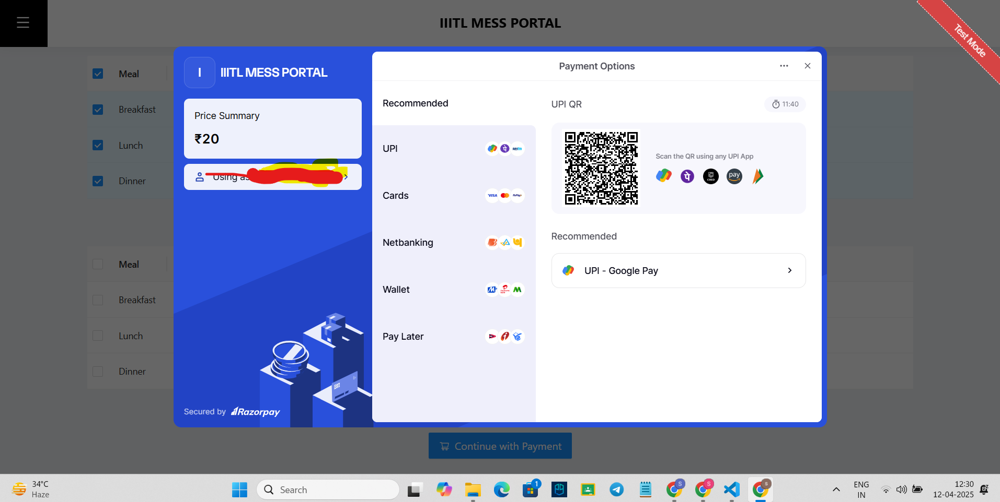
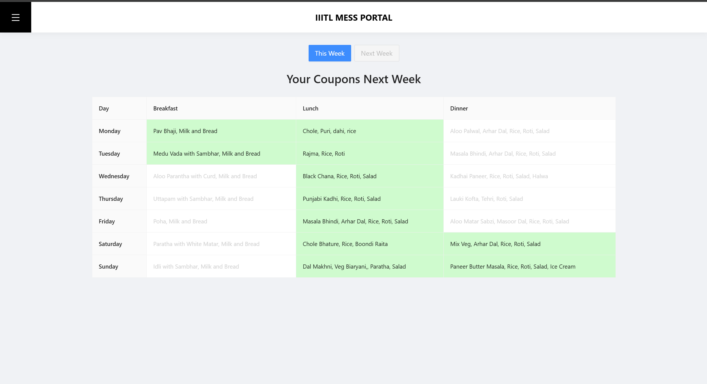
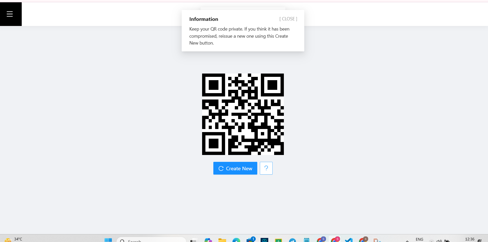
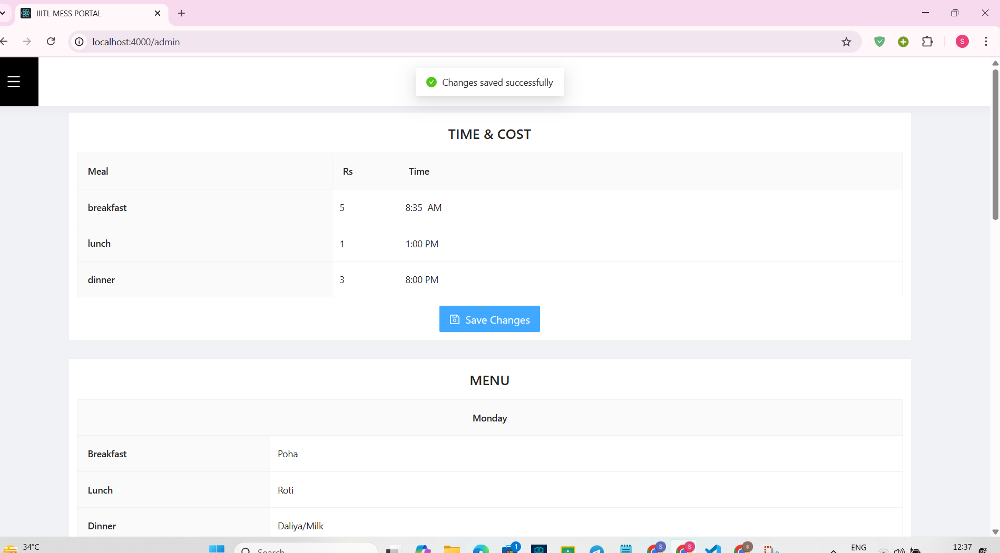
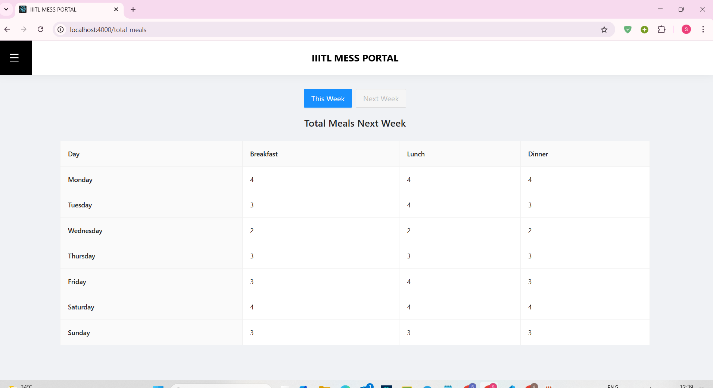
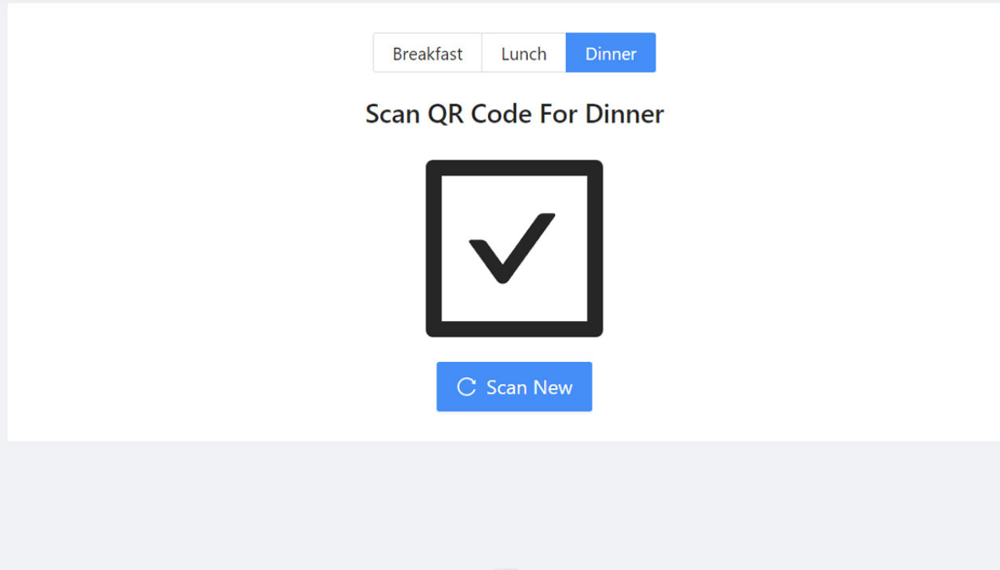

1# Mess Management Platform for IIIT LUCKNOW

This platform is tailored for IIIT LUCKNOW to streamline mess management by providing distinct interfaces for mess supervisors and students. It offers efficient tools for managing daily operations and a user-friendly interface for meal selection and purchasing.

## For Mess Supervisors

The supervisor portal provides a centralized platform to efficiently manage mess operations through the following features:

- **Weekly Menu Management:** Easily create, update, and manage meal menus for the entire week.
- **Meal Timing Management:** Modify breakfast, lunch, and dinner schedules according to operational needs.
- **Flexible Pricing Management:** Set and update meal prices whenever required.
- **Meal Demand Tracking:** Monitor student meal selections to estimate the total quantity of food to be prepared.
- **QR Code-Based Verification:** Scan and authenticate unique QR codes to verify meal coupons and prevent unauthorized usage.
- **Secure Online Payments:** Enable seamless and secure transactions through integrated Razorpay payment services.

## For STUDENTS

The student interface is designed to deliver a seamless and intuitive experience:

- **Comprehensive Weekly Menu:**  
  Access detailed weekly menus, including meal timings and pricing information.
- **Effortless Meal Selection and Purchase:**  
  Select meals for the forthcoming week using an intuitive checkbox system, with automatic calculation of the total payable amount.
- **Order History Access:**  
  Review a complete history of purchased meal coupons covering both current and future weeks.
- **Unified QR Code System:**  
  Utilize a single, static QR code in lieu of traditional paper coupons; the option to regenerate the QR code is available in case of security concerns.

## Detailed Project Overview

### Student Interface

- **Homepage Display:**  
  The landing page exhibits mess timings and the weekly menu in a clear and easily navigable layout.  
  

- **Secure Authentication:**  
  Students are required to sign in using their Google accounts. Access is restricted to authorized domains (e.g., `iiitl.ac.in`) to ensure system security.  
  

- **Meal Coupon Selection Process:**  
  An interactive interface allows students to select their preferred meals for the next week via checkboxes. The system computes the total cost in real time.  
  

- **Payment Gateway Redirection:**  
  Upon clicking "Continue with Payment," students are seamlessly redirected to Razorpay’s secure payment gateway to complete the transaction.  
  

- **Order Management:**  
  A dedicated section maintains a detailed record of all purchased meal coupons, accessible for both current and forthcoming weeks.  
  

- **QR Code Assignment:**  
  Each student is provided with a unique static QR code, which can be displayed on a smartphone or printed. The system supports QR code regeneration if necessary.  
  

### Supervisor Interface

- **Control Dashboard:**  
  The supervisor dashboard empowers administrative users to update meal prices, adjust service times, and manage the weekly menu in real time.  
  

- **Meal Preparation Summary:**  
  A summarized view of meal orders is provided, detailing the total number of meals to be prepared based on current coupon purchases for the ongoing and upcoming weeks.  
  

- **QR Code Scanning and Validation:**  
  Supervisors can verify meal coupons with an integrated QR code scanning feature. Valid codes are confirmed with a check mark, while invalid or already redeemed codes are indicated with a cross.  
  A “Scan New” functionality facilitates uninterrupted scanning of successive codes.  
  
